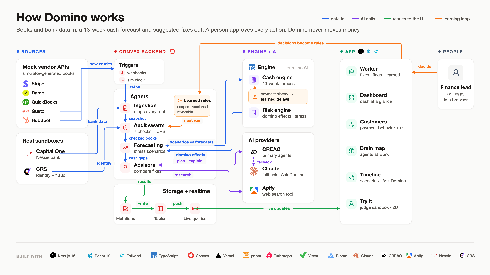

<p align="center">
  
</p>

# Domino

**An AI cash-flow analyst for B2B software companies.** Domino reads a company's finance tools,
audits them, builds a 13-week cash forecast, shows the chain of problems one bad event sets off
(the "dominoes"), and tests costed fixes as branches of the timeline. A person accepts or declines
every fix. Domino never moves money.

**Live app:** https://domino-ruddy.vercel.app · **Built at** Cal Hacks 13.0 for Hyphenate's
autonomous finance track · **Setup:** [docs/SETUP.md](docs/SETUP.md)

---

## For judges

### The problem

Cash runs out one late payment at a time. A big customer pays 30 days late, cash drops below
the lender's limit, hiring freezes, bills slip. The FP&A analyst who owns the cash forecast
usually finds out from a spreadsheet that was already out of date when it was built.

### The seat it fills

The **FP&A analyst who owns the cash forecast**, working with the controller and CFO.

### What to try (about 3 minutes)

| Page | What you see |
| --- | --- |
| **Judge sandbox** (`/judge`) | Your own private sandbox company. Pick its data sources, upload your own CSV rows or add a surprise, then press Play and watch the agents react. |
| **Worker** (`/field`) | Press **Start agents**. Ingestion, audit, forecasting and advisor agents run on a simulated clock. |
| **Brain map** (`/field/map`) | Every source, agent and output as a live graph of the work being done. |
| **Timeline** | The 13-week cash forecast. Ask Domino "what if our biggest customer pays 60 days late?" or "what if rates rise?" and get a new branch with its dominoes and costed fixes. |
| **2U backtest** (`/case/2u/backtest`) | A real public company. Forecast from Nov 2023 filings, then reveal what 2U actually reported. |

### What makes it different

- **Dominoes, not just a forecast.** Each event shows the next problems it causes, up to four
  levels deep, so you see *why* a week goes under the minimum.
- **Every fix is simulated before anyone approves it.** Suggestions link to saved forecast runs,
  so the cost and timing of a fix are visible (some "helpful" fixes cost cash before they pay back).
- **AI proposes, math decides.** Agents explain and propose changes; a pure, tested engine
  computes every number in integer cents.
- **It learns from you.** Flagging or declining a finding becomes a scoped rule that later audit
  and advisor runs apply.

### What is real and what is simulated

| Part | Status |
| --- | --- |
| Demo companies (Kestrel Data and others) | Simulated, based on public SaaS filings |
| 2U case study | Real public filings with publication dates; later results kept separate from forecasts |
| Billing, CRM, cards, books, payroll | Our mock servers that copy real API shapes (Stripe, HubSpot, Ramp, QuickBooks, Gusto) |
| Bank | Capital One Nessie API |
| News signals | Real Apify runs on public pages |
| Forecast, dominoes, fixes, learning | Real code with tests |

The 2U replay is retrospective: we picked the case after the outcome was known. It shows the
method, not proof that Domino would have predicted the outcome.

### Sponsor tracks

- **Hyphenate:** a finance seat with limited access, a clear record of every agent step, and a
  person approving every action. [Coverage and gaps](kb/product/hyphenate-checklist.md).
- **Convex:** the only database and backend (details below).
- **CREAO:** agent apps for learning the company, with a Claude fallback.
- **Capital One Nessie:** the bank account behind the cash balance.
- **Apify / CRS:** counterparty news signals and identity checks.

---

## Technical overview



### Stack

| Layer | Technology |
| --- | --- |
| Frontend | Next.js 16, React 19, TypeScript, Tailwind, shadcn/Radix, React Flow (brain map), Motion, D3/SVG charts. Hosted on Vercel. |
| Backend and database | Convex: queries, mutations, actions, HTTP actions, scheduled functions, realtime `useQuery`, paginated queries |
| Engine | Pure TypeScript in `packages/engine`: forecast, 13-week direct cash flow statement, dominoes, audit checks, advisor, learning. No network, no clock, no randomness. |
| Contracts | Zod schemas in `packages/contracts` validate every boundary (APIs, agent output, JSON) |
| AI | Claude (`claude-opus-5-5` by default) and CREAO agent apps behind one interface in `packages/agents` |
| Data sources | Mock tool servers (`apps/mocks`), Capital One Nessie, Apify, SEC EDGAR filings |

### How data flows

1. **Ingest.** Connectors pull from the mock tools and Nessie. Signed vendor webhooks hit Convex
   HTTP actions, which verify the signature and schedule a debounced re-ingest.
2. **Audit.** An audit swarm checks the books against each other (for example billing vs bank)
   and writes findings.
3. **Forecast.** Parallel forecasters build the 13-week direct cash flow statement. Per-customer
   payment delays feed the forecast.
4. **Advise.** The advisor proposes fixes as `Change` objects. The engine scores each fix on a
   saved timeline branch.
5. **Decide and learn.** A person accepts or declines. Decisions become scoped rules for later runs.

A simulated clock (self-rescheduling Convex jobs with a lease) plays the company forward day by
day, so the whole loop runs live while you watch.

### How we use Convex

- HTTP actions verify signed vendor webhooks (Stripe, Gusto, Ramp, Nessie): `apps/web/convex/http.ts`, `fieldWebhooks.ts`
- Scheduled functions run the simulated clock and the agent swarms: `fieldClock.ts`, `fieldAudit.ts`, `fieldAnalyst.ts`, `fieldAdvisor.ts`
- A composed schema with 43 tables and 69 indexes holds immutable snapshots, findings, suggestions and timeline branches: `apps/web/convex/schemas/`
- Realtime `useQuery` keeps the dashboard, brain map, worker page and Timeline live with no refresh
- The agent activity feed uses a paginated query with `usePaginatedQuery`

### Design rules we enforce

- **Money is integer cents.** No floating-point money anywhere.
- **The engine is pure.** The same input always gives the same output, so every number can be reproduced.
- **Agents never calculate money.** They return proposed changes; the engine computes the result.
- **No peeking.** The engine, agents and UI cannot read the simulator's answer key; a test enforces this.
- **Mocks only** for payment, card, CRM and payroll tools. Domino never moves money.

### Repo map

| Path | What it is |
| --- | --- |
| `apps/web` | Next.js UI and Convex backend (`apps/web/convex/`) |
| `apps/mocks` | Mock servers for billing, CRM, cards, books, payroll |
| `packages/contracts` | Shared types, Zod schemas, fixtures |
| `packages/engine` | Forecast, dominoes, audit, advisor, learning. Pure functions with Vitest tests. |
| `packages/sim` | Simulated companies, events, planted errors, answer key (used only by evals) |
| `packages/agents` | Claude and CREAO adapters behind one interface |
| `docs/` | [Setup](docs/SETUP.md), [demo data](docs/SETUP-DATA.md), [architecture](docs/architecture/README.md) |
| `kb/` | Spec, decisions, task cards, handoffs |
| `skills/` | Plain-markdown development skills used by every coding agent |

### Testing

```sh
pnpm check     # typecheck, Vitest tests, Biome lint
```

Build log with commits for each feature: [hackathon.md](hackathon.md).
