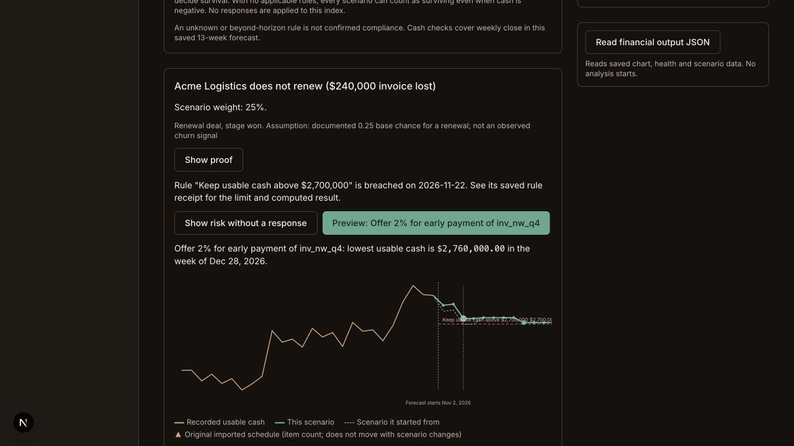
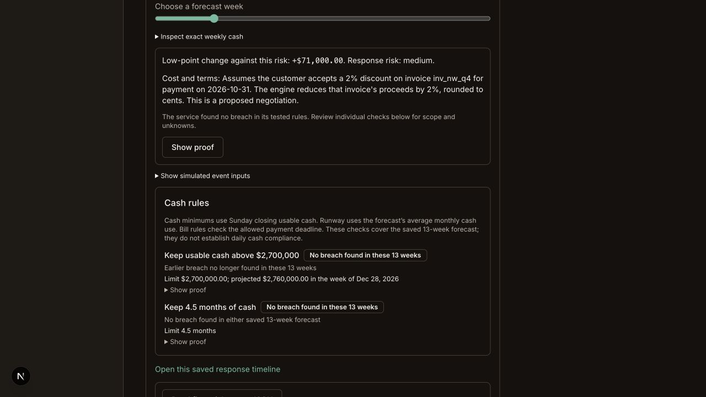
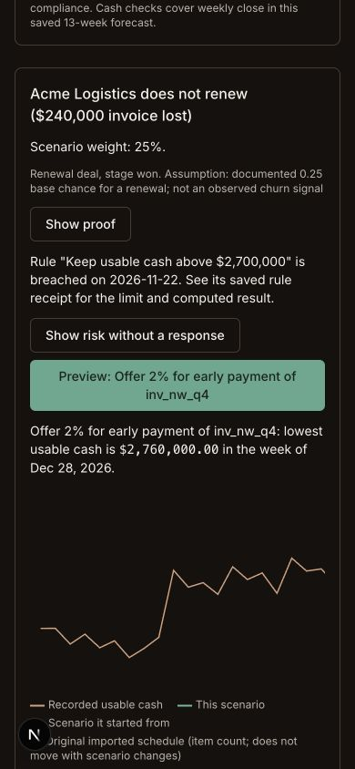
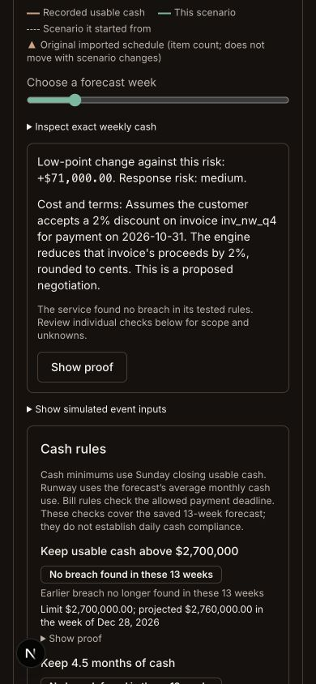

# TL6–TL7 isolated acceptance

Status: accepted locally on TL7-checkpoint. TL5 remains at `597fcc0` in `/Users/micahlai/code/domino-timeline`; its app3107/backend3240/3241 and smoke-test tab stay open. User forbids merging into TL5 until explicitly instructed. No main/lane-main merge or push.

## Implemented

- TL6: `timeline/output:get` returns strict versioned JSON with supported WeeklyResultRefV1 health, exact saved 26/13 chart, rule proof and up to20 direct saved scenarios. Reads do not run engines/providers or write. Unknown runway remains null. Final output cap900,000 UTF-8 bytes; bounded scenario prefixes disclose truncation. Field adoption is a separate joint gate.
- TL7: reviewed manual start launches a bounded background analysis using existing engine scan/forecast/stress/score/rank. Saved risk and costed response scenarios retain exact frozen input/rule versions and apply risk ancestry once. No actions execute. Queued/running/succeeded/partial/failed receipts, exact request bindings, duplicate delivery,120-second expiry and separate reviewed retries are covered.
- UI: saved analysis/history, scope/assumptions, risk/response chart toggles, cost terms, rule proof, immutable scenario links and financial JSON inspection/download. No job starts on page open. Real rule-set hashes differ from individual rule hashes; both are checked against the selected source. Narrow-screen failure text is separated from its proof button.

## Verification

Final combined `pnpm check`: **1,942 tests** (contracts496, engine344, sim5, agents298, web799), five package typechecks, lint381 files. Separate Convex typecheck and production build pass. Import inventory remains18 legacy cross-lane imports, zero harness crossings. Shared contracts, engine, root schema and Dashboard.tsx are unchanged.

- TL6 has19 focused boundary tests. TL7 backend has15 focused tests plus10 independent scratch probes; [independent review](TL7-backend-review.md) accepts backend9e87c77. UI has30 focused boundary/render/request tests. The integrated analysisAcceptance test proves actual backend receipts fit the UI and both output parsers, including fractional4.5-month rules, response ancestry/engine equality and quiet reads.
- Isolated live API:22 checks pass through the actual scheduled job, immutable saved children, scoped reads/requests and export. [Check list](evidence/TL7-live-checks.json). Wrong-company reads return none; unreviewed launches, changed request payloads and event ancestry reject.
- Actual browser review/start transitions through progress to completion. A real saved response changes the selected chart/rule proof; output JSON and saved-history reload work. Desktop and390px screenshots below. Phone document width390 matches viewport390. Final observed console error list empty.

## Reproduce

Worktree `/Users/micahlai/.codex/worktrees/tl7-checkpoint/domino-ai`, own app3108/backend3250/3251. Ignored anonymous deployment created without copying TL5 env, credentials or data; no provider configured. Seed is labelled synthetic Kestrel with explicitly reviewed neutral assumptions.

[Saved analysis](http://127.0.0.1:3108/c/kestrel/timeline/analysis?runId=timeline%3Aworkspace%2F34e274c86109c6f434eeff7114d415336e07e802&analysisId=timeline%3Aanalysis%2F10be46715ec93bb3e2ea52f5c7a3a3f5120891d8abbfd0f63fb121554dee46f8) uses a$2.7M weekly minimum and4.5-month runway rule. The source already breaches the cash minimum: risk low$2,689,000 week Nov16,2026, short$11,000 on Nov22. A2% early-payment discount on actual Northwind invoice inv_nw_q4 moves the saved low to$2,760,000 week Dec28, +$71,000, with the previous cash breach resolved. This is a hypothetical negotiation, not approved payment. The Acme nonrenewal weight25% is a documented assumption, not observed churn.

## Checkpoint limits and decisions

Analysis starts only from baseline/rule-only runs with no cumulative events because shared stressTest lacks ancestor input. At most3 risks and2 improving responses each,8 changes per scenario; source limits2,000 records/24 open invoices/24 deals/32 recurring costs/32 rules. Deterministic templates need no language provider. A14-day late-payment fallback has explicit0.1 stress weight only if the model supplies no risk. Imported assumptions are never silently replaced.

Weighted scenario index covers overlapping scenarios and frozen minimum-cash/payment-deadline rules, with no responses applied; it excludes runway/unknown results and is not a survival probability. With no applicable rules even negative cash may count as surviving, disclosed beside the index. Any incomplete financial stage withholds the index. Unknown rules are not passing. Fees and vendor/customer consent remain unmodeled. TL8 rejoin, real Field ingestion/export/adoption, production authorization and financial action execution are outside this acceptance.

All decisions and status stay feature-local under the independent lane ownership. See [fixed wire](TL6-TL7-interface.md), [smoke guide](SMOKE-TESTS.md) and [handoff](HANDOFF.md).
