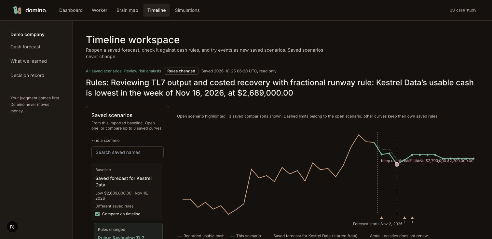
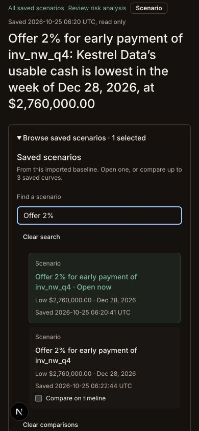

# Saved scenario sidebar acceptance

Accepted locally on TL7-checkpoint after worker53ea673 and subscription repair34053b7 (integrated2c07c44). TL5 remains597fcc0 with its3107/3240 smoke preview open. No TL5/main/lane-main merge or push. User requests saved scenarios in a sidebar and on the timeline without clutter.

## Delivered

A desktop sidebar lists the current imported-baseline family, highlights the open scenario, shows parent nesting, supports name search and links to the all-company catalog. Duplicate names show save times. Long names wrap/clamp with full title. Narrow screens use a collapsed scenario picker. The existing workspace playground includes the same controls with labelled fixtures.

Open links navigate to a saved run. Compare checkboxes only load saved curves: up to three noncurrent forecasts, including parent, validated for company, baseline, seed and exact weekly dates. Current cash stays highlighted; other curves use quiet, distinct dashes and compact linked legends. Default comparison is parent or first direct child. No money is calculated in the browser, and no simulation/provider/write is started by browsing. Clear removes the optional reads/curves. The graph lists at most100 family entries and discloses the cap. Comparison choices reset when opening another run or reloading; saved forecasts remain unchanged.

## Verification

- Integrated full `pnpm check`: **1,948 tests**, five package typechecks, lint385 files. Production build passes. Backend source is unchanged; earlier TL7 Convex typecheck remains applicable.
- Independent reviewer reran49 focused workspace/comparison tests and5 scratch probes. [Audit](TL7S-review.md) records identity/calendar/money boundaries, missing/current fallback, query bounds, labels and subscription stability.
- Actual live browser: initial source loads, default parent draws, selecting saved risk and response produces exactly three comparison paths; further unselected controls disable. The chart legend opens the exact saved response with$2,760,000 low point and resolved rule proof. Mobile390px picker opens, filters to two duplicate response names with save times, Space toggles comparison, Clear removes all optional curves while the current result stays unchanged. Document width390 equals viewport390. Final fresh-tab error/warning list empty. Desktop screenshot uses actual default1512px viewport; temporary phone override reset.
- Live browser initially caught a React render loop missed by the structural tests. The repaired query bag is memoized on company and three primitive selected IDs, matching installed Convex subscription requirements. Reopened connected browser and all selection/navigation/keyboard/clear steps above pass after repair.
- Taste fixes: limit optional curves/reads to three including parent; wrap long labels and distinguish duplicate names; keep selected curve above muted comparisons and move input panels below chart for width. Rules drawn on chart belong to the open scenario; differing saved rule versions are labelled. No dashboard/navigation/shared-style/schema/contracts/engine changes.

The new3108 preview and stable3107 TL5 tab are both retained. [Smoke guide](SMOKE-TESTS.md) includes links and steps. Field adoption and TL8 remain separate gates.
