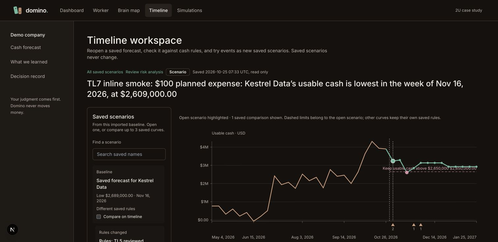
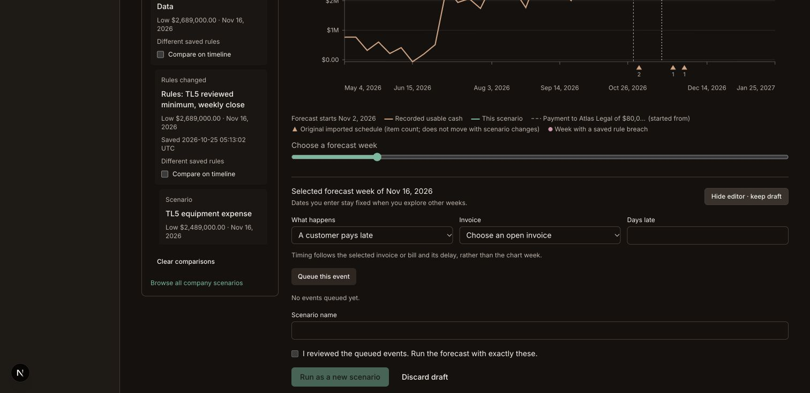
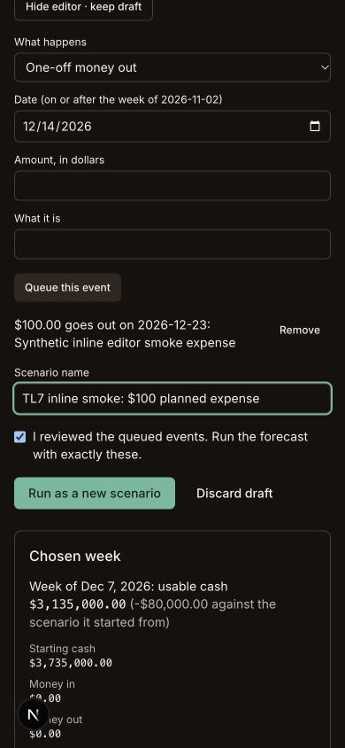

# Timeline scales and contextual scenario creation

Implementation integrated on TL5-checkpoint: chart217b957 at8773177; contextual editorcb7f094 at196d154. User explicitly authorized TL7 merge into TL5, then requested axis scales and in-timeline scenario creation. Accepted locally after actual Chrome desktop/phone verification. User reloaded in Chrome after the earlier stale error-page block; the live save/reopen gate is now complete.

- Chart has actual saved-week date axis, exact currency-axis guides, negative/flat range support and retained comparison/week controls. No interpolated financial readout.
- Below the chart, selected-week context and Add scenario open an inline editor. Fresh cash events start from selected week; invoice/bill timing remains record-based. True forecast start remains the validation minimum.
- Hiding retains draft/queued changes; chart navigation never rewrites entered dates. Review binds exact queued changes/name; changed queue requires renewed review. Scheduled-item prefill is explicit. Discard is explicit. Existing simulation/save path unchanged.
- Combined pnpm check passes1,963 tests (web820), five typechecks and lint391. Production build passes. Lead reran15 focused scale/composer tests. [Source review](TL7XC-review.md).
- Backend3240 query confirms original Atlas Legal scenario still has13 weeks, low$2,609,000 and$41,000 shortfall. Existing data/env retained. No main/Field/dashboard/contracts/engine/root-schema/global styles or provider changes; no push.
- Runtime runs on existing3107/3240/3241 with its existing data. Actual Chrome1512px and390px checks pass: selectedNov23 cash date default, keyboard-editedDec23 date retained while navigating chart and hiding/reopening, queued event and exact confirmation retained, one inline form, no page overflow (width390/scrollWidth390), and no final console errors/warnings. Temporary viewport override reset.
- Confirmed browser save creates `timeline:workspace/aca904d0ddd1a388af53fb1a99a09af81b79fd98`: exact10,000-cent expense on2026-12-23, parent Atlas Legal changes applied once, and no other forecast change. Backend equality checked week by week; parent remains unchanged. Browser reload reopens the same saved result. No financial action executed.
- Phone taste repair: prevent Remove from shrinking/wrapping and give small editor buttons a minimum32px height. Full1,963-test/typecheck/lint/build check repeated after repair and passes.

[Open saved browser smoke result](http://127.0.0.1:3107/c/kestrel/timeline?runId=timeline%3Aworkspace%2Faca904d0ddd1a388af53fb1a99a09af81b79fd98). Chrome is left open with the inline editor ready.

Use [TL5 smoke preview](http://127.0.0.1:3107/c/kestrel/timeline?runId=timeline%3Aworkspace%2F4d9835e8174efa96ff9c5974380cb755e199ad14). Select a forecast week, Add scenario, choose money in/out, inspect/edit date, queue event, hide/reopen, change chart week and verify date/queue remain. Review and Run as a new scenario to save. Daily financial actions are never executed.
