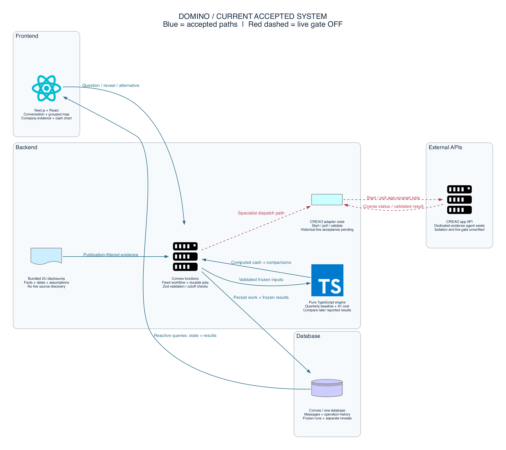
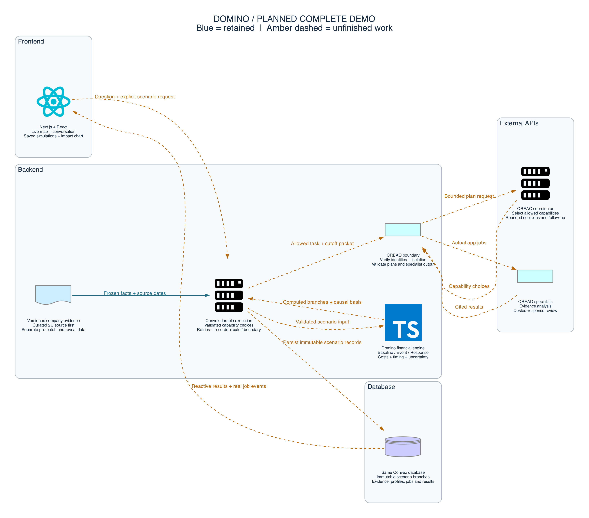

# Domino: one shared product plan

Status checked October 24, 2026. Accepted preview: feature checkpoint 0f87ed2, coordination checkpoint d7b562a. S3 38297d4 is not accepted. Remote S2 is still 1154972. This document supersedes the old Kestrel pitch for the current demo.

## What the product does

Domino is a financial investigation workspace. It helps a financial planning analyst answer three questions: What did we know? What cash outcome did we expect? What would a different decision cost or change?

Our first case is 2U. We replay public financial information available at a selected past date. Domino saves a cash forecast before the user reveals later results. The user compares the forecast with reported results and tests an explicit hypothetical event and a costed response.

This is a retrospective case study. We chose the case and method after the outcome was known. It does not prove that Domino predicted the failure in advance or could have prevented bankruptcy. Public quarterly reports do not give us real weekly transactions. An estimated path is a projection, not observed history.

The main screen is a map of real work. Domino is the central agent. Sources, tools, specialists and outputs appear as actual jobs run. A separate Company Knowledge node opens the stored evidence. A persistent conversation panel stays beside the map. The financial chart opens from an output or the Simulations page.

## Features and current status

| Feature | Current status | What still needs work |
| --- | --- | --- |
| Workspace, Company and Simulations navigation | Accepted | Connect the complete saved list and new scenarios |
| Grouped source/tool map, node details, stored instruction profiles, operation motion | Accepted UI and fixed-job execution | Real coordinator and live historical specialist acceptance |
| Company facts, sources, publication dates, assumptions and evidence links | Accepted for curated 2U | Live discovery, reconciliation and learned company knowledge are not done |
| Quarterly forecast and saved input record | Accepted | S3 must accept the actual saved baseline format |
| Later reported results, stored separately from predictions | Accepted | Keep all new scenario views separate from observed results |
| Existing A1 costed alternative | Accepted | It has upfront cost and no target-quarter benefit; do not call it a rescue |
| Baseline -> hypothetical Event -> Response | Contracts accepted; engine implemented but blocked in audit | Repair S3, save branches in S4, wire UI in U2 |
| All saved investigations in one list | S2 reserved for friend | Implement read-only list and status handling |
| Job records, messages, immutable forecast inputs, read-only reload | Accepted foundation | Extend integrity and retry checks to scenarios |
| CREAO adapter | Implemented with bounded polling | Dedicated instructions, identity, isolation and coordinator cycle not verified |
| Always-on updates | Existing backend jobs can outlive the page while local backend runs | Product freshness schedule, change detection and hosted operation are not complete |
| Learning and prediction improvement | Not proved for the historical product | Store dated feedback; evaluate proposed model changes on unused periods before claiming improvement |

The last accepted feature checkpoint passed 1,185 tests, typecheck, lint, production build and actual browser checks. This is evidence of software checks, not a forecast-accuracy score or proof that unfinished features work.

## Order and ownership

| Order | Work | Owner | Completion gate |
| --- | --- | --- | --- |
| 1A | S2: list and reopen saved investigations | Friend's Claude | Read-only query; correct statuses; bounded reads; focused tests; Codex audit |
| 1B, parallel | S3 repair: accept real saved baseline provenance | Jayden's Claude | Real 2U regression; wrong inputs still rejected; Codex money/date audit |
| 2 | S4 design: exact scenario storage, APIs and hashes | Codex | Reviewed design; preserve old records; freeze response evidence and hindsight labels |
| 3 | S4 implementation: save Event/Response branches | Jayden's Claude | Repeated requests do not duplicate; changed requests conflict; corrupted records fail; reload reads only |
| 4 | U2: connect full saved simulation flow | One Claude UI writer | Real list, event form, impact chain and chart; desktop/mobile/keyboard audit |
| Parallel required gate | Verify CREAO; implement one real coordinator cycle | Codex verifies; human launches scoped Claude implementation | Actual capability choices and specialist jobs; bounded access; no later-data leakage claim without proof |
| 5 | Complete journey, failure tests and submission proof | Codex audits; team records demo | Ask, inspect work, forecast, reveal, event, response and reopen all work visibly |

The user launches Claude manually. Codex reviews and integrates only checked work into preview/historical-overnight. Main stays unchanged. Friend owns S2 until they finish or ownership is explicitly transferred. No duplicate local S2 worker.

After the core demo, add source conflict resolution, dated user feedback, one controlled source-update wakeup, and held-out forecast evaluation. These are extensions, not claims about the current build. Broad company onboarding, arbitrary connectors, unlimited agents, more themes and automatic financial actions are deferred.

## Hyphenate fit, with gaps shown

The official Cal Hacks prize page lists four judging questions and the submission package. Read directly from the rendered page on October 24: [official prize page](https://hive.hackberkeley.org/prizes). The public page mentions a longer track brief but did not expose its contents here. The broader items below come from our saved team checklist and mentor notes, not a newly verified full official brief.

| Official criterion | Domino's answer | Evidence or remaining gap |
| --- | --- | --- |
| Realistic work and proof | A real public company, dated disclosures, exact cash calculations, saved forecasts and later observations | Core works. Still need full live journey and a clear real/derived/hypothetical table. One retrospective case is not proof of accuracy |
| A useful employee with bounded access | Seat: financial planning analyst who owns cash forecasts. Evidence and scenario specialists assist. People decide; Domino does not move money | Stored work records and safe profiles exist. Real coordinator, access/isolation verification and a formal approve/reject workflow are incomplete |
| A new approach | Inspect the actual research work and financial consequences together, with a historical replay that makes assumptions visible | This is our proposed distinction. Do not claim that no other product has done it |
| A standout moment | Ask for a fix, then show why its upfront cost makes near-term cash worse before benefits start. Defend that result with evidence and engine math | Existing A1 supports this honest story. Full Event/Response UI and question-driven agent execution still need completion |
| Submission package | Video starts with the standout moment; working live demo; one sentence naming the seat; proof of what is real and simulated | Still to prepare and rehearse. Judges may ask for their own scenario, so expose the supported amount, dates and uncertainty rather than claiming arbitrary simulation |

Every item in the old team checklist is mapped here:

| Team brief or mentor theme | Current fit | Gap / decision |
| --- | --- | --- |
| One company and one part of finance | 2U cash planning | Keep one defensible case |
| A few clear seats | Planning analyst; evidence and scenario specialists | Human controller/CFO role is a target workflow, not implemented organizational permissions |
| The company's systems, people and mistakes | Public reports and documented cash definitions | Private systems, staff behavior and operational errors are not reconstructed as facts |
| Sources disagree | Separate total cash from usable cash; preserve provenance | This is a definition difference, not full multi-source reconciliation. Conflict detection remains a gap |
| Decisions have later effects | Response costs now; benefits start later | Done for current A1 model; broader timing models deferred |
| Work with people | User initiates investigations, reveal and alternatives | Formal approve/reject feedback and stored decisions are not complete |
| Limited access | No money movement; validated inputs; provider gates | Production authentication and role enforcement are not established by the demo |
| Explainable and accountable | Frozen inputs, sources, saved jobs and separate observed results | Extend the same guarantees to S4 scenarios |
| Learn the company | Inspectable frozen knowledge | Automatic discovery and learned mappings are not done |
| Improve predictions | Saved forecasts can be compared with later results | No demonstrated improvement. Requires evaluation on unused periods |
| Plug into any company | Not in current scope | General connectors and onboarding deferred |

We do not yet satisfy every broader theme. Call: finish one truthful complete journey first, then choose the smallest remaining track gap. Counterargument: the narrow historical case has less enterprise integration and autonomy than the original vision, which may reduce track strength. The coordinator and proof of real work must therefore remain required gates.

## Actual technology

| Layer | Technology and responsibility |
| --- | --- |
| Frontend | Next.js 16, React 19, TypeScript. React Flow for the map. Motion for operation animations. Radix/shadcn-style components, Tailwind and Lucide for UI. Existing SVG/D3 chart for finance |
| Backend | Convex queries, mutations, actions and scheduled jobs. Owns workflow state, validation, retries and records |
| Contracts and engine | Zod validates inputs and outputs. Pure TypeScript computes money in integer cents with exact arithmetic helpers. AI does not calculate cash |
| Database | One Convex database. Stores conversations, operations, frozen historical runs, reveals and activity. Planned scenarios extend these records |
| Data | Curated 2U disclosure bundle with publication dates, facts and explicit assumptions. No live discovery in the accepted path |
| External AI | Existing CREAO app-scoped API. Adapter exists; historical live acceptance and coordinator remain gated. Claude Code is a development tool, not proof of runtime agents |
| Delivery | pnpm workspace and Git worktrees. Tests use Vitest. Current preview and Convex backend run locally. Hosting is not claimed |

No AWS/GCP database, Redis, separate vector database, live banking connector or Apify Actor is required by this diagram. An API key in an environment file does not mean a feature is integrated.

## Architecture diagrams

Blue connections are accepted. Red dashed connections are blocked live integration. Amber dashed connections are planned or unfinished. Icons for Convex and CREAO are neutral library icons because this script uses no custom vendor artwork. Database boxes show logical record groups in the same Convex database.

The planned diagram is the smallest complete demo, not the entire long-term vision. Source monitoring, arbitrary connector creation and proven learning are not silently included.

Source: [diagram.py](../../docs/architecture/diagram.py). Uses the requested [mingrammer/diagrams library](https://diagrams.mingrammer.com/docs/getting-started/installation). Graphviz renders the files. Run instructions are in [architecture README](../../docs/architecture/README.md).
